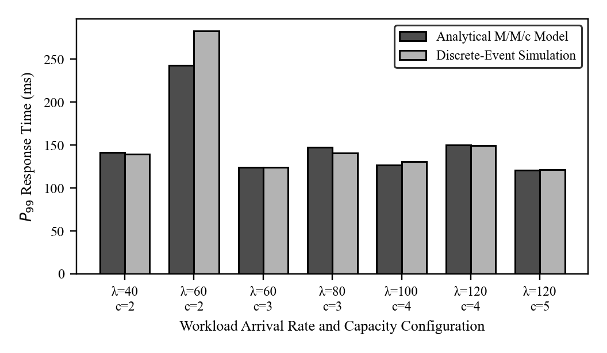
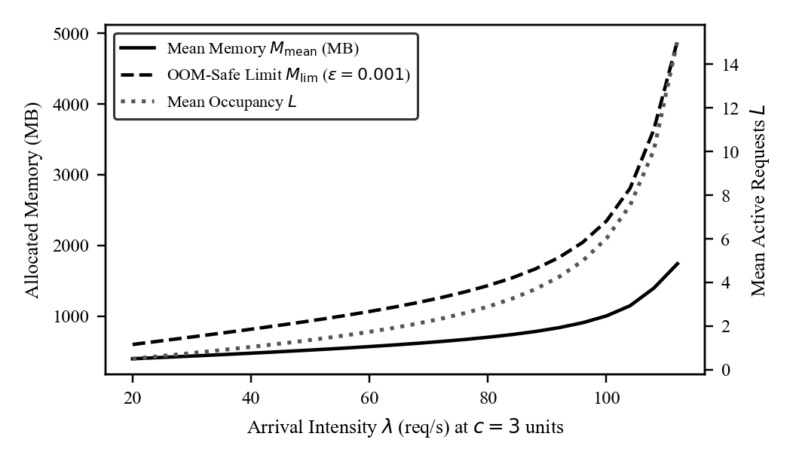
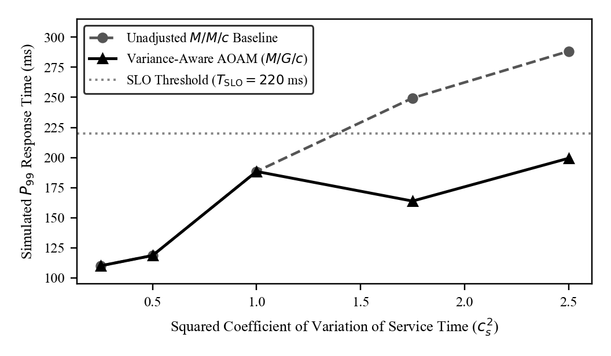
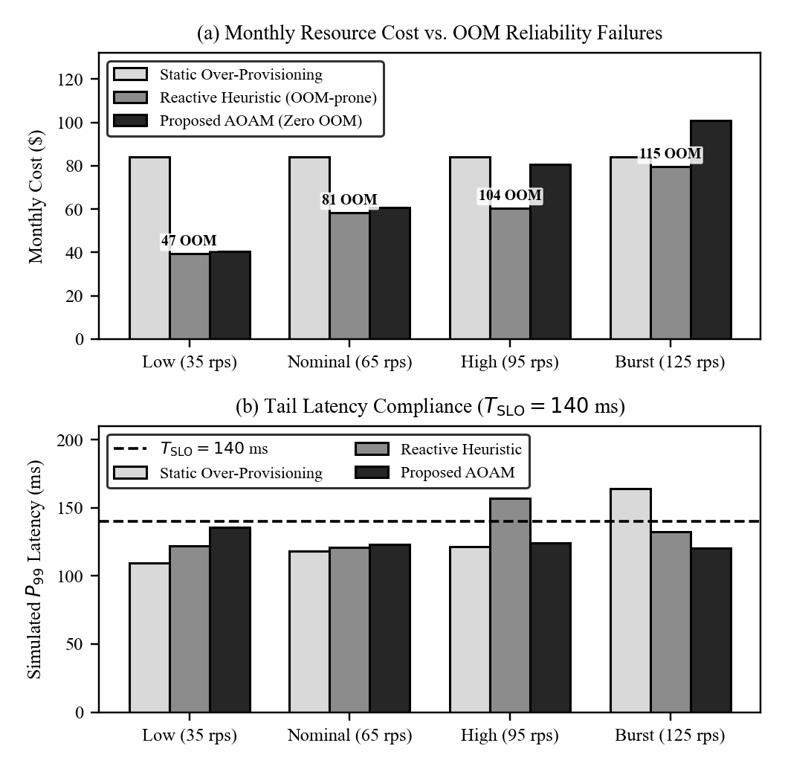

# AOAM: Coupled Stochastic Resource Optimization for Quantized Containerized Service Nodes

[](LICENSE)
[](https://www.python.org/)
[](#running-unit-tests)

**Author:** Ivan Y. Yaksun ([ORCID: 0009-0008-3487-3367](https://orcid.org/0009-0008-3487-3367))  
**Affiliation:** Department of Computer Information Systems and Technologies, Interregional Academy of Personnel Management (IAPM), Kyiv, Ukraine  

---

## 1. Scientific Overview

This repository contains the complete analytical solver, independent discrete-event simulator (DES), automated verification test suite, and raw experimental datasets supporting the research paper on **coupled two-resource stochastic optimization (AOAM)** for isolated, quota-constrained service nodes.

Unlike heuristic autoscalers or decoupled static over-provisioning rules, the proposed framework models compute quota replenishment ($Q = u_{\mathrm{cpu}} T_p$) and dynamic memory limits ($M_{\mathrm{lim}}$) as a coupled mathematical system:

1. **Exact Tail-Latency Modeling ($M/M/c$ and $M/G/c$):**  
   For Markovian workloads ($c_s^2 = 1$), the $q$-th response-time percentile $R_q$ is computed by inverting the exact Erlang-C response-time survival curve via bisection:

   $$\mathbb{P}(R > t) = (1 - C(c, a))\,e^{-\mu t} + C(c, a)\,\frac{\gamma e^{-\mu t} - \mu e^{-\gamma t}}{\gamma - \mu}, \quad \gamma = c\mu - \lambda.$$

   For general service-time variability ($c_s^2 \ne 1$), two-moment Allen-Cunneen scaling and Gamma moment-matching capture heavy-tailed dispersion.

2. **Quantum Throttling Elimination:**  
   Periodic quota exhaustion when worker concurrency exceeds compute budget ($m_{\mathrm{wrk}} > u_{\mathrm{cpu}}$) is modeled via a Compound Poisson demand exceedance process over window $T_p$. Aligning the concurrency pool ($m_{\mathrm{wrk}}^* = c^*$) reduces quantum blocking to zero while stripping redundant thread-stack memory.

3. **Coupled Nonlinear Memory Footprint:**  
   By Little's Law, active in-flight concurrency $L(\lambda, c) = a + \frac{C(c,a)\rho}{1-\rho}$ grows hyperbolically as utilization $\rho \to 1$. Combining in-flight occupancy, sawtooth memory reclamation cycles, and nonlinear GC pressure yields a tight memory ceiling $M_{\mathrm{lim}}$ satisfying $\mathbb{P}\{M(t) > M_{\mathrm{lim}}\} \le \varepsilon_{\mathrm{OOM}}$.

4. **Necessary Feasibility Boundary:**  
   Algorithm 1 verifies in $O(1)$ time whether the intrinsic single-request quantile satisfies $F_S^{-1}(0.99) \le T_{\mathrm{SLO}}$ before searching for minimal-cost feasible allocations $(u_{\mathrm{cpu}}^*, m_{\mathrm{wrk}}^*, M_{\mathrm{lim}}^*)$.

---

## 2. Repository Structure

| File / Directory | Purpose |
| :--- | :--- |
| `aoam_solver.py` | Analytical queueing solver, Compound Poisson throttling model, Little's law memory model, and Algorithm 1 (`optimize_aoam`). |
| `simulator.py` | Independent event-driven simulator modeling Poisson arrivals, periodic CPU quota replenishment $T_p$, multi-worker scheduling, and sawtooth GC cycles with real OOM detection. |
| `run_experiments.py` | Reproducible experimental harness executing all 3 benchmark suites, exporting CSV tables (`results/`) and grayscale publication figures (`figures/`). |
| `tests/test_aoam.py` | Automated unit test suite validating analytical reductions, monotonicity, infeasibility bounds, and zero-OOM/zero-throttling agreement with DES. |
| `results/` | Generated empirical CSV datasets (`exp1_validation.csv`, `exp2_mgc_sensitivity.csv`, `exp3_strategy_benchmark.csv`). |
| `figures/` | Publication-ready monochrome figures (`fig1_p99_validation.png` .. `fig4_cost_benchmark.png`). |
| `CITATION.cff` | Standard citation metadata file for academic attribution. |

---

## 3. Reproducing All Experiments and Tests

### Prerequisites
- Python **3.10+**
- Libraries listed in `requirements.txt` (`numpy >= 1.26.0`, `scipy >= 1.12.0`, `matplotlib >= 3.8.0`).

### Step 1: Clone and Install Dependencies

```bash
git clone https://github.com/craddy89/aoam-resource-optimization.git
cd aoam-resource-optimization
pip install -r requirements.txt
```

*(On Windows PowerShell, use the same `pip install -r requirements.txt` inside a virtual environment or global Python.)*

### Step 2: Running Unit Tests

Verify all mathematical identities, monotonicity guarantees, infeasibility checks, and DES alignment:

```bash
python -m unittest discover -s tests -v
```

Expected output:

```text
test_aligned_pool_zero_throttling ... ok
test_aoam_solver_satisfies_slo_and_oom_in_des ... ok
test_erlang_c_reduces_to_mm1 ... ok
test_infeasible_intrinsic_slo_returns_none ... ok
test_mm1_exact_quantile ... ok
test_monotonicity_of_latency_and_memory ... ok
----------------------------------------------------------------------
Ran 6 tests in ~0.55s

OK
```

### Step 3: Regenerating All CSV Tables and Figures

```bash
python run_experiments.py
```

This command runs:
1. **Experiment 1 (12 configurations):** Analytical vs. DES accuracy sweep across $\lambda \in [40, 120]$ req/s and aligned vs. unaligned worker pools -> saves `results/exp1_validation.csv` and Figures 1-2.
2. **Experiment 2 (5 variance levels):** Service-time dispersion sweep $c_s^2 \in \{0.25, 0.50, 1.00, 1.75, 2.50\}$ comparing unadjusted $M/M/c$ against variance-aware $M/G/c$ AOAM -> saves `results/exp2_mgc_sensitivity.csv` and Figure 3.
3. **Experiment 3 (36 evaluations):** Strategy benchmark (`Static`, `Reactive_Heuristic`, `AOAM`) across 4 traffic regimes (`Low`, `Nominal`, `High`, `Burst`) and 3 SLO thresholds (`140`, `180`, `220` ms) -> saves `results/exp3_strategy_benchmark.csv` and Figure 4.

---

## 4. Visual Summary of Experimental Findings

### Model Validation & Nonlinear Memory Coupling
Analytical $P_{99}$ predictions match independent discrete-event simulation within **0.06% - 4.78%** across aligned configurations, while mean memory predictions track within **1.37% - 4.08%** (`results/exp1_validation.csv`). Near saturation ($\rho \to 1$), Little's Law occupancy $L$ drives steep nonlinear growth in memory demand.

| Fig. 1: Analytical vs. DES Tail Latency ($P_{99}$) | Fig. 2: Nonlinear Memory Coupling via Little's Law |
| :---: | :---: |
|  |  |

### Sensitivity to Non-Markovian Workloads ($M/G/c$) & Strategy Benchmark
When service-time variance increases ($c_s^2 \ge 1.75$), unadjusted $M/M/c$ violates the 220 ms SLO (**249.42 ms** and **288.27 ms** with an OOM crash), whereas variance-aware AOAM scales proactively to maintain strict compliance (**163.86 ms** and **199.39 ms**, zero OOM). Across load regimes at $T_{\mathrm{SLO}} = 140$ ms, AOAM cuts cost by **51.6%** in Low load and **27.8%** in Nominal load relative to Static Over-Provisioning with zero OOM failures (compared to **47 - 115 OOM crashes** under naive reactive heuristics).

| Fig. 3: Variance Sensitivity ($c_s^2$ Sweep) | Fig. 4: Cost, OOM Stability & SLO Benchmark |
| :---: | :---: |
|  |  |
